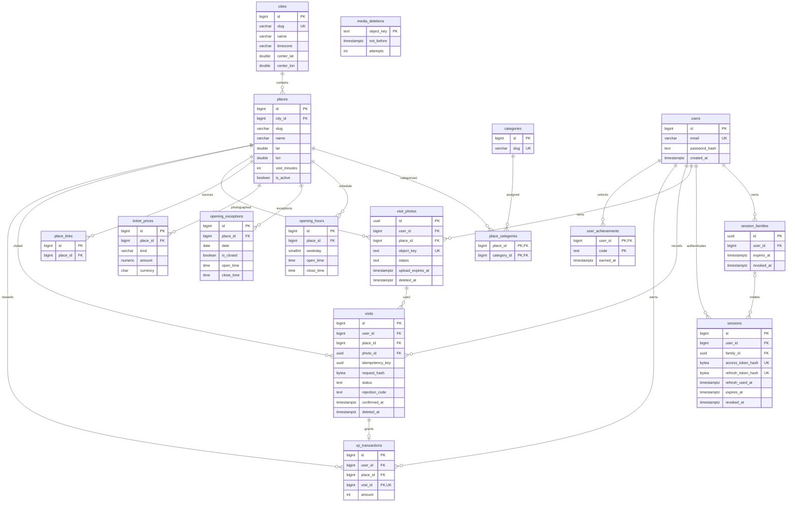

# Схема базы данных

Схема соответствует миграциям `000001`–`000016` в `backend/migrations`.
Источник истины — SQL миграций. Диаграмма показывает связи и ключевые поля.

## Каталог

`places` уникален по `(city_id, slug)`. Повторный импорт сохраняет ID места.
Связующие категории используют составной первичный ключ. Расписание допускает
несколько интервалов в один день, исключение уникально по `(place_id, date)`.
Цены представлены `NUMERIC(10,2)` в BYN, планировщик сравнивает целые копейки.
Часовой пояс берётся из города.

## Сессии и посещения

Пароли хранятся как Argon2id-хеши. В таблице `sessions` находятся SHA256-хеши
access/refresh токенов. `session_families` задаёт абсолютный срок refresh-family
и её отзыв. `family_id` допускает NULL для сессий, созданных до миграции 15.

Составной внешний ключ `(photo_id, user_id, place_id)` связывает посещение
с фотографией того же владельца и места. Триггер блокирует и проверяет готовность
фото при подтверждении. Одно фото используется максимум одним подтверждённым
посещением, отклонённые попытки могут ссылаться на него повторно.

Ключ `(user_id, idempotency_key)` уникален. `request_hash` позволяет отличить
повтор того же запроса от изменённого тела. GPS-координаты используются при
проверке запроса. Сохраняются время фиксации, вычисленное расстояние и точность.

## XP, достижения и коллекция

`xp_transactions` уникален по `(user_id, place_id)` и `visit_id`. Составной
внешний ключ включает владельца, место и статус `confirmed`. Сумма одной
награды ограничена CHECK `amount = 100`. Подтверждение и первая награда
записываются в одной транзакции.

Триггер миграции 16 выдаёт достижения за 1, 5 и 10 открытых мест.
`user_achievements` сохраняет дату первого получения. Уровень вычисляется
из суммы XP, коллекция из первых наград за её три места. Эти значения
вычисляются при чтении API.

## Удаление и файлы

`visits.deleted_at` скрывает запись из истории, `visit_photos.deleted_at`
закрывает доступ к фото. Журнал XP и запись идемпотентности сохраняются.
Удаление аккаунта каскадно удаляет его сессии, фото, посещения, XP и достижения.

Файлы находятся в приватном S3/MinIO/R2, таблица `visit_photos` содержит их
метаданные. `media_deletions` сохраняет задания физического удаления по
`object_key`, независимо от срока жизни аккаунта и метаданных фото.
В этой таблице отсутствует внешний ключ владельца. Worker учитывает
`not_before` и повторяет удаление при сбоях хранилища.

Служебная `goose_db_version` ведётся Goose. `schema_version` создана начальной
миграцией и содержит историческую запись версии 1. Текущую применённую версию
проверять через `make migrate-status`.
